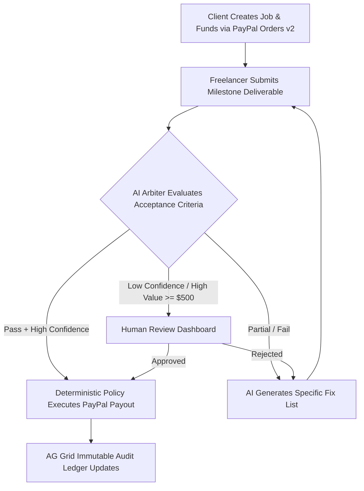

<div align="center">

  # 🏛️ ArbiterPay
  
  ### 🤖 AI-Verified Milestone Escrow on PayPal
  
  <p>
    <b>Eliminating freelance payment disputes through neutral, explainable AI arbitration and automated PayPal escrow.</b>
  </p>

  <!-- Hackathon & Status Badges -->
  <p>
    
    
    
  </p>

  <!-- Tech Stack Badges -->
  <p>
    
    
    
    
    
    
    
  </p>

  <a href="https://arbiterpay.onrender.com"><strong>🌐 Live Hosted App (Render) »</strong></a> •
  <a href="#getting-started">🚀 Quick Start</a> •
  <a href="#architecture">🏛️ Architecture</a> •
  <a href="#how-it-works">⚙️ How it Works</a> •
  <a href="#sponsor-integrations">🏆 Sponsor Tools</a>

</div>

---

## 🌟 The Problem & Solution

> *"Freelancers deliver and don't get paid; clients pay and don't get what they ordered."*

Traditional escrow relies on slow, expensive human mediation. **ArbiterPay** introduces a neutral **AI Arbiter** that sits on the critical path of payments:
1. **Client Funds Escrow:** The client creates a job with 2-4 verifiable milestones and funds it through PayPal Sandbox checkout (**Orders v2** create & capture).
2. **Freelancer Submits Proof:** The freelancer submits deliverables (code repo, tests, text).
3. **AI Arbitrates:** The AI Arbiter evaluates the deliverable against agreed acceptance criteria and returns a structured, schema-valid JSON verdict with per-criterion cited evidence and confidence scores.
4. **Deterministic Policy Moves Money:** If verified with high confidence, funds are instantly released to the freelancer's account via **PayPal Payouts**.
5. **Human-in-the-Loop Safeguards:** Low-confidence results (< 0.75) or high-value milestones (≥ \$500) automatically route to a Human Review Dashboard with AI evidence attached.
6. **Immutable Audit Ledger:** Every decision, webhook event, and payment transaction is recorded in an **AG Grid** audit ledger.

---

## ⚙️ How It Works (Workflow)



---

## 🛡️ Non-Negotiable Design Principles

1. **The AI Never Moves Money:** The AI returns a structured JSON verdict. A deterministic policy layer in code makes the payout decision.
2. **Strict Idempotency:** A milestone can never be paid twice, even under repeated clicks or duplicate webhooks.
3. **Evidence-Backed Verdicts:** Every verdict requires status, reasoning, quoted evidence, confidence, model identifier, and prompt version.
4. **Safety Thresholds:** Verdicts below confidence threshold (0.75) or above high-value threshold (\$500) route to human review.

---

## 🏆 Sponsor Integrations

- **PayPal:** Orders v2 checkout and capture, Payouts batch releases, and Webhooks notifications.
- **AG Grid:** Filterable, interactive audit ledger displaying system events and AI decisions at `/ledger`.
- **Render:** Hosted web service and PostgreSQL database deployed at https://arbiterpay.onrender.com.
- **APIMatic:** OpenAPI contracts and Context Plugin patterns documented in [`docs/apimatic.md`](./docs/apimatic.md).

---

## 🚀 Quick Start / Setup Instructions

### 1. Clone & Install
```bash
git clone https://github.com/zerokali20/ArbiterPay.git
cd ArbiterPay
npm install
```

### 2. Configure Environment Variables
Copy `.env.example` to `.env`:
```env
# PayPal Sandbox
PAYPAL_CLIENT_ID=your_client_id
PAYPAL_CLIENT_SECRET=your_client_secret
PAYPAL_API_BASE=https://api-m.sandbox.paypal.com

# AI Arbiter (Optional - built-in deterministic fallback for zero credit accounts)
ANTHROPIC_API_KEY=your_key_here
ARBITER_MODEL=claude-3-5-sonnet-latest

# Database
DATABASE_URL=postgresql://...
```

### 3. Run Locally
```bash
npm run dev
```
Open **[http://localhost:3000](http://localhost:3000)** in your browser.

### 4. Run Policy & Idempotency Test Suite
```bash
npx tsx test/policy.test.ts
```

---

## 🧪 Demo Test Credentials (PayPal Sandbox)

| Role | Sandbox Email | Usage |
| :--- | :--- | :--- |
| **Client** | `sb-bhnlh53339270@business.example.com` | Job creation & escrow funding |
| **Freelancer** | `sb-okeek53339723@personal.example.com` | Milestone payout receiver |
