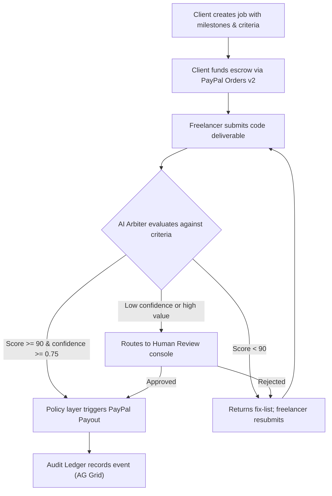

<div align="center">

  # ArbiterPay

  ### AI-Verified Milestone Escrow on PayPal Sandbox

  <p>
    <b>An autonomous escrow platform where an AI arbiter evaluates code deliverables against objective criteria and triggers PayPal payouts — no human bottleneck required.</b>
  </p>

  <!-- Hackathon & Status Badges -->
  <p>
    
    
    
  </p>

  <!-- Tech Stack Badges -->
  <p>
    
    
    
    
    
    
    
  </p>

  <a href="https://arbiterpay.onrender.com"><strong>Live Demo (Render) &raquo;</strong></a> &bull;
  <a href="#quick-start">Quick Start</a> &bull;
  <a href="#architecture">Architecture</a> &bull;
  <a href="#api-routes">API Routes</a> &bull;
  <a href="#sponsor-integrations">Sponsor Tools</a>

</div>

---

> **Disclaimer:** ArbiterPay is a hackathon prototype demonstrating escrow logic on the PayPal **sandbox**. It is not a licensed escrow service and does not handle real money.

---

## The Problem

Freelancers deliver work and don't get paid. Clients pay up front and don't get what they ordered. Traditional platforms mediate disputes with human agents who lack the technical context to evaluate code — costing weeks and eroding trust on both sides.

## The Solution

ArbiterPay removes the human bottleneck for **objective, verifiable** deliverables (code with tests, scripts against a spec). An LLM-powered AI arbiter evaluates submitted code against pre-agreed acceptance criteria and produces a structured JSON verdict with per-criterion evidence. A **deterministic policy layer** — never the AI itself — decides whether to release funds via PayPal Payouts.

---

## How It Works



**Key safety rule:** The AI never moves money. It returns a verdict. Code decides.

---

## Architecture

```
ArbiterPay/
├── app/                          # Next.js 15 App Router
│   ├── page.tsx                  # Landing / overview dashboard
│   ├── not-found.tsx             # Custom 404
│   ├── layout.tsx                # Root layout + navbar
│   ├── jobs/
│   │   ├── new/page.tsx          # Contract builder (templates, milestones, criteria)
│   │   └── [id]/page.tsx         # Live job detail — fund, submit, view verdict
│   ├── review/page.tsx           # Human Review console (disputes, demos)
│   ├── ledger/page.tsx           # AG Grid audit ledger with filters & inspector
│   └── api/
│       ├── jobs/route.ts         # POST: create job
│       ├── jobs/[id]/route.ts    # GET: fetch job + milestones
│       ├── jobs/[id]/fund/route.ts # POST: PayPal Orders v2 create & capture
│       ├── submissions/route.ts  # POST: submit code → AI eval → payout
│       ├── ledger/route.ts       # GET: audit events
│       └── webhooks/paypal/route.ts # POST: PayPal webhook receiver
├── lib/
│   ├── paypal.ts                 # PayPal REST v2 client (Orders, Payouts, Auth)
│   ├── arbiter.ts                # AI arbiter (Claude tool-use + Zod schema)
│   ├── policy.ts                 # Deterministic payout policy engine
│   ├── ledger/index.ts           # Append-only ledger writer (DB + in-memory)
│   └── jobsStore.ts              # In-memory job store for demo fallback
├── db/
│   ├── index.ts                  # Drizzle ORM client
│   └── schema.ts                 # PostgreSQL schema (jobs, milestones, ledger)
├── components/
│   └── Navbar.tsx                # Global navigation bar
├── worker/                       # Background worker (webhook + arbiter jobs)
├── test/
│   └── policy.test.ts            # Policy & idempotency test suite
├── docs/
│   └── apimatic.md               # APIMatic integration notes
├── scripts/                      # Utility scripts
├── drizzle.config.ts             # Drizzle migration config
└── .env.example                  # Environment variable template
```

---

## Design Principles

| # | Principle | Implementation |
|---|-----------|---------------|
| 1 | **AI never moves money** | AI returns a Zod-validated JSON verdict; a deterministic policy function calls Payouts |
| 2 | **Idempotent payouts** | Milestone status check + unique batch ID prevent double-pay on retries or duplicate webhooks |
| 3 | **Evidence-backed verdicts** | Every verdict stores: per-criterion result, quoted evidence, confidence, model name, prompt version |
| 4 | **Human-in-the-loop** | Confidence < 0.75 or milestone amount >= \$500 auto-routes to Human Review instead of auto-release |
| 5 | **Append-only audit** | Every payment event and AI decision is written to an immutable ledger table, viewable via AG Grid |
| 6 | **Secrets in env only** | `.env` is gitignored; `.env.example` committed with placeholders |

---

## Quick Start

### 1. Clone & Install

```bash
git clone https://github.com/zerokali20/ArbiterPay.git
cd ArbiterPay
npm install
```

### 2. Configure Environment

Copy `.env.example` to `.env` and fill in your values:

```bash
cp .env.example .env
```

Required variables:

| Variable | Description |
|----------|-------------|
| `DATABASE_URL` | PostgreSQL connection string (Render provides this) |
| `PAYPAL_CLIENT_ID` | PayPal sandbox REST app client ID |
| `PAYPAL_CLIENT_SECRET` | PayPal sandbox REST app client secret |
| `PAYPAL_API_BASE` | `https://api-m.sandbox.paypal.com` |
| `ANTHROPIC_API_KEY` | Claude API key (optional — deterministic fallback built in) |
| `ARBITER_MODEL` | e.g. `claude-sonnet-4-20250514` |
| `NEXT_PUBLIC_APP_URL` | Your deployed URL or `http://localhost:3000` |

### 3. Run Database Migrations

```bash
npx drizzle-kit push
```

### 4. Run Locally

```bash
npm run dev
```

Open **http://localhost:3000** in your browser.

### 5. Run Tests

```bash
npx tsx test/policy.test.ts
```

---

## PayPal Sandbox Test Accounts

| Role | Sandbox Email | Type | Country | Usage |
|------|--------------|------|---------|-------|
| **Client (Payer)** | `sb-bhnlh53339270@business.example.com` | Business | LK | Creates jobs & funds escrow |
| **Freelancer (Receiver)** | `sb-okeek53339723@personal.example.com` | Personal | LK | Receives milestone payouts |

These accounts are pre-configured in the Create Job form as defaults.

---

## API Routes

| Method | Route | Description |
|--------|-------|-------------|
| `POST` | `/api/jobs` | Create a new escrow job with milestones and criteria |
| `GET` | `/api/jobs/[id]` | Fetch job details and milestone list |
| `POST` | `/api/jobs/[id]/fund` | Fund escrow via PayPal Orders v2 (create + capture) |
| `POST` | `/api/submissions` | Submit code for AI evaluation and automatic payout |
| `GET` | `/api/ledger` | Retrieve audit ledger events |
| `POST` | `/api/webhooks/paypal` | Receive and verify PayPal webhook notifications |

---

## Sponsor Integrations

### PayPal (Central Integration)
- **Orders v2**: `createOrder` + `captureOrder` for milestone escrow funding
- **Payouts API**: Batch payout release to freelancer's PayPal email upon AI approval
- **Webhooks**: Signature-verified event processing for payment state changes

### AG Grid (Audit Ledger)
- Interactive, filterable audit ledger at `/ledger`
- Columns: Timestamp, Event Type, Actor, AI Score (0–100), Amount, Job ID, Milestone
- Category filters: Payments & Escrow, AI Evaluations, Policy Routing
- Click-through inspector with raw event payload and cross-page navigation

### Render (Hosting)
- Web service + PostgreSQL deployed at https://arbiterpay.onrender.com
- Auto-deploys on push to `main`

### APIMatic
- OpenAPI specification documented in [`docs/apimatic.md`](./docs/apimatic.md)

---

## AI & Tools Used

| Tool | Purpose |
|------|---------|
| **Claude (Anthropic)** | AI arbiter — evaluates code submissions against acceptance criteria using tool-use with strict Zod JSON schema output |
| **PayPal Orders v2 + Payouts** | Payment infrastructure — escrow funding and milestone payout release |
| **AG Grid** | Interactive audit ledger table with filtering, sorting, and detail inspector |
| **Next.js 15 (App Router)** | Full-stack React framework with TypeScript API routes |
| **Drizzle ORM** | Type-safe PostgreSQL ORM with migration support |
| **Render** | Cloud hosting (web service + managed PostgreSQL) |
| **Zod** | Runtime schema validation for AI verdict structure |

---

## Pages

| Page | URL | Description |
|------|-----|-------------|
| Overview | `/` | Landing dashboard with project stats |
| Create Job | `/jobs/new` | Contract builder with templates, milestones, criteria, budget calculator |
| Job Detail | `/jobs/[id]` | Fund escrow, submit code, view AI verdict and payout status |
| Human Review | `/review` | Dispute resolution console with AI evidence and interactive demos |
| Audit Ledger | `/ledger` | AG Grid table of all payment events and AI decisions |

---

## License

[MIT](./LICENSE)
